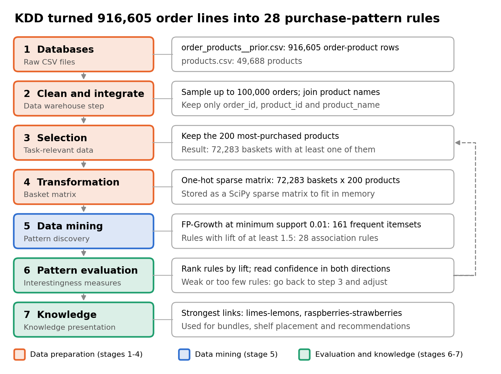
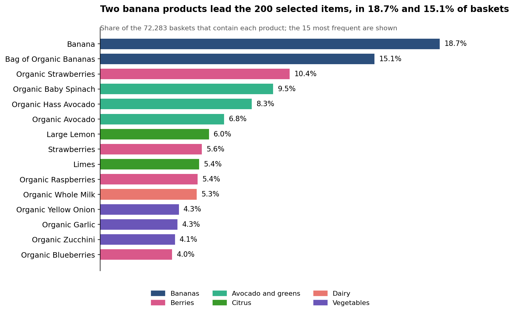
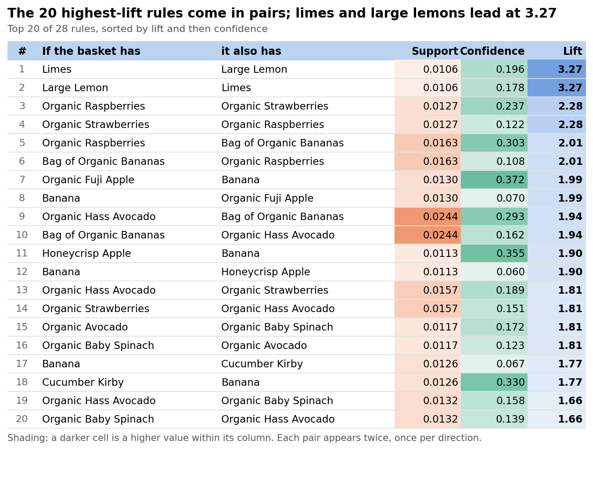
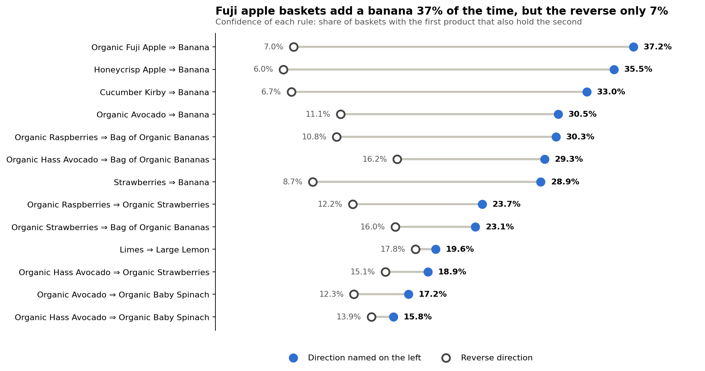
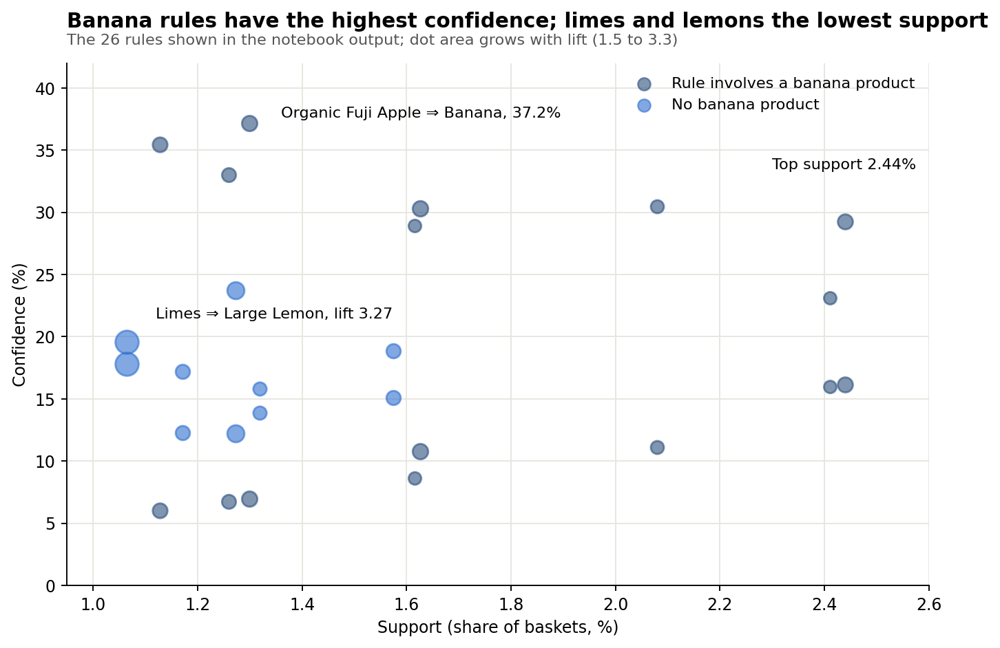

<div align="center">

# 🛒 Market Basket Analysis of Instacart Grocery Orders

### Association Rule Mining with FP-Growth


*Which groceries do customers buy together, and how can a retailer act on it?*

</div>

---

## 📑 Table of Contents

1. [Overview](#-overview)
2. [Key Results](#-key-results)
3. [Dataset](#-dataset)
4. [Workflow: the KDD Process](#-workflow-the-kdd-process)
5. [Parameters](#-parameters)
6. [Results](#-results)
7. [Business Recommendations](#-business-recommendations)
8. [Limitations](#-limitations)
9. [How to Run](#-how-to-run)
10. [Project Structure](#-project-structure)
11. [Literature Review Summary](#-literature-review-summary)
12. [References](#-references)

---

## 🔎 Overview

Online grocery platforms record every basket a customer checks out. This project mines those baskets with **association rules** of the form *X ⇒ Y* ("shoppers who buy X also tend to buy Y") using the **FP-Growth** algorithm on the Instacart Market Basket Analysis dataset, following the full **Knowledge Discovery in Databases (KDD)** process.

Three measures judge every rule:

| Measure | Formula | Meaning |
|---|---|---|
| **Support** | P(X ∪ Y) | Share of baskets containing both X and Y |
| **Confidence** | P(X ∪ Y) / P(X) | Share of baskets with X that also contain Y |
| **Lift** | P(X ∪ Y) / (P(X) · P(Y)) | How much more often X and Y appear together than independent buying predicts (lift > 1 means a real link) |

---

## 🏆 Key Results

| 🧺 Baskets mined | 🥑 Products kept | 📦 Frequent itemsets | 🔗 Rules (lift ≥ 1.5) | ⭐ Strongest lift |
|:---:|:---:|:---:|:---:|:---:|
| **72,283** | **200** | **161** | **28** | **3.27** (limes ⇒ large lemon) |

- 🍋 **Limes and large lemons** are the strongest pair, bought together about 3.3 times as often as chance predicts.
- 🍌 **8 of the 13 displayed pairs** involve a banana product.
- ↔️ **Direction matters:** a Fuji apple in the basket leads to a banana **37.2%** of the time, but a banana leads to a Fuji apple only **7.0%** of the time.

---

## 📦 Dataset

[Instacart Market Basket Analysis](https://www.kaggle.com/datasets/psparks/instacart-market-basket-analysis): an anonymised collection of grocery orders from Instacart users. Only two files are needed.

| File | Columns used | Rows loaded in the notebook |
|---|---|---:|
| `order_products__prior.csv` | `order_id`, `product_id` | 916,605 |
| `products.csv` | `product_id`, `product_name` | 49,688 |

---

## 🧭 Workflow: the KDD Process

Each of the seven KDD stages maps to one block of the notebook. The dashed arrow is the feedback loop: an earlier, looser configuration (more products, lower support) did not finish mining in 20 minutes, so the parameters were tightened.

<div align="center">
  
  <br><sub><b>Figure 1.</b> KDD process applied to the Instacart data (adapted from Han, Kamber and Pei).</sub>
</div>

---

## ⚙️ Parameters

| Parameter | Value | Role |
|---|---:|---|
| `N_ORDERS` | 100,000 | Upper limit on sampled orders |
| `TOP_PRODUCTS` | 200 | Number of most-purchased products kept |
| `MIN_SUPPORT` | 0.01 | Smallest share of baskets for a frequent itemset |
| `MIN_LIFT` | 1.5 | Smallest lift for a rule to be kept |
| `RANDOM_STATE` | 42 | Seed for reproducible sampling |
| Algorithm | FP-Growth (MLxtend) | Frequent-itemset mining |

---

## 📊 Results

### Run summary

| Quantity | Value |
|---|---:|
| Order lines loaded | 916,605 |
| Products in the catalogue | 49,688 |
| Baskets after selection | 72,283 |
| Products kept | 200 |
| Frequent itemsets (support ≥ 0.01) | 161 |
| Association rules (lift ≥ 1.5) | 28 |

> The notebook printed the top 20 rules and a "Banana" look-up, which together cover 26 of the 28 rules. The other two have the lowest lifts, between 1.50 and 1.53.

### Most frequent products

Fresh produce dominates: 11 of the 15 most frequent products appear in more than 5% of baskets.

<div align="center">
  
  <br><sub><b>Figure 2.</b> Single-item supports from the FP-Growth output, coloured by product group.</sub>
</div>

### Top 20 association rules

<div align="center">
  
  <br><sub><b>Figure 3.</b> Top 20 of 28 rules, sorted by lift then confidence (darker shade = higher value in the column).</sub>
</div>

<details>
<summary><b>Same table as text (click to expand)</b></summary>

| # | If the basket has | it also has | Support | Confidence | Lift |
|--:|---|---|--:|--:|--:|
| 1 | Limes | Large Lemon | 0.0106 | 0.196 | **3.27** |
| 2 | Large Lemon | Limes | 0.0106 | 0.178 | **3.27** |
| 3 | Organic Raspberries | Organic Strawberries | 0.0127 | 0.237 | **2.28** |
| 4 | Organic Strawberries | Organic Raspberries | 0.0127 | 0.122 | **2.28** |
| 5 | Organic Raspberries | Bag of Organic Bananas | 0.0163 | 0.303 | **2.01** |
| 6 | Bag of Organic Bananas | Organic Raspberries | 0.0163 | 0.108 | **2.01** |
| 7 | Organic Fuji Apple | Banana | 0.0130 | 0.372 | **1.99** |
| 8 | Banana | Organic Fuji Apple | 0.0130 | 0.070 | **1.99** |
| 9 | Organic Hass Avocado | Bag of Organic Bananas | 0.0244 | 0.293 | **1.94** |
| 10 | Bag of Organic Bananas | Organic Hass Avocado | 0.0244 | 0.162 | **1.94** |
| 11 | Honeycrisp Apple | Banana | 0.0113 | 0.355 | **1.90** |
| 12 | Banana | Honeycrisp Apple | 0.0113 | 0.060 | **1.90** |
| 13 | Organic Hass Avocado | Organic Strawberries | 0.0157 | 0.189 | **1.81** |
| 14 | Organic Strawberries | Organic Hass Avocado | 0.0157 | 0.151 | **1.81** |
| 15 | Organic Avocado | Organic Baby Spinach | 0.0117 | 0.172 | **1.81** |
| 16 | Organic Baby Spinach | Organic Avocado | 0.0117 | 0.123 | **1.81** |
| 17 | Banana | Cucumber Kirby | 0.0126 | 0.067 | **1.77** |
| 18 | Cucumber Kirby | Banana | 0.0126 | 0.330 | **1.77** |
| 19 | Organic Hass Avocado | Organic Baby Spinach | 0.0132 | 0.158 | **1.66** |
| 20 | Organic Baby Spinach | Organic Hass Avocado | 0.0132 | 0.139 | **1.66** |

</details>

### Direction matters

Both directions of a pair share the same support and lift but not the same confidence, because confidence divides by the popularity of the starting product. Bananas are in 18.7% of baskets, so shoppers who start from a rarer product (a Fuji apple, a Kirby cucumber) lead to bananas far more often than the reverse.

<div align="center">
  
  <br><sub><b>Figure 4.</b> Confidence in both directions for 13 product pairs (three values derived as rule support ÷ item support).</sub>
</div>

### Support, confidence and lift together

None of the 26 displayed rules has support above 2.5%, and the highest-lift rule sits at the low-support end. Confidence ranges from 6.0% to 37.2%.

<div align="center">
  
  <br><sub><b>Figure 5.</b> Support against confidence for 26 of the 28 rules; dot area grows with lift.</sub>
</div>

---

## 💡 Business Recommendations

| Action | Evidence |
|---|---|
| 🎁 **Bundles** | Limes with lemons (lift 3.27) and raspberries with strawberries (2.28) are natural "fresh pack" candidates |
| 🎯 **Recommend in the stronger direction** | Offer bananas to shoppers who add a Fuji apple (37.2%), not apples to every banana buyer (7.0%) |
| 🏬 **Placement** | Products in high-lift pairs, such as avocados and bananas, can sit near each other in the app and in the store |
| 🧪 **Test before roll-out** | These are co-purchase patterns, not causes, so run an A/B test for each action |

---

## ⚠️ Limitations

- Only the 200 most-purchased products were mined, so rules among rarer items are not found.
- The most frequent products are mostly fresh fruit and vegetables, so the rules mainly describe produce.
- The order file loaded holds 916,605 lines, well below the roughly 3 million orders of the full release, and Instacart notes its public data is a biased subset. The rules describe this extract, not all Instacart shoppers.
- Lift can be unreliable for items with low counts, and no significance test was applied.
- Time, customer and store effects are ignored.

---

## 🚀 How to Run

```bash
# 1. Install dependencies
pip install pandas numpy scipy mlxtend matplotlib jupyter

# 2. Download the dataset from Kaggle and unzip it into ./instacart
#    (needs order_products__prior.csv and products.csv)

# 3. Open the notebook
jupyter notebook instacart_association_rules.ipynb

# or run the script
python instacart_association_rules.py
```

**Tuning tips**

- Mining too slow or out of memory? Lower `TOP_PRODUCTS` and `N_ORDERS`, or raise `MIN_SUPPORT`.
- No rules found? Lower `MIN_SUPPORT` or `MIN_LIFT` one small step at a time.
- Outputs are saved as `frequent_itemsets.csv` and `association_rules.csv`.

---

## 🗂️ Project Structure

```
.
├── README.md
├── instacart_association_rules.ipynb    # full notebook with outputs
├── instacart_association_rules.py       # script version
├── images/
│   ├── kdd_process.png
│   ├── top_products.png
│   ├── top_rules_table.png
│   ├── rule_direction.png
│   └── rule_scatter.png
└── instacart/                           # dataset folder (not included)
    ├── order_products__prior.csv
    └── products.csv
```

---

## 📚 Literature Review Summary

<details>
<summary><b>Summary of the 25 reviewed papers (click to expand)</b></summary>

| Ref. | Authors (year) | Contribution | Relevance to this project |
|:-:|---|---|---|
| [1] | Agrawal, Imieliński, Swami (1993) | Defined association rule mining on sales data | Problem definition |
| [2] | Agrawal, Srikant (1994) | Apriori level-wise algorithm | Baseline method |
| [3] | Agrawal et al. (1996) | Consolidated Apriori-family algorithms | Baseline method |
| [4] | Park, Chen, Yu (1995) | Hash-based candidate reduction | Efficiency idea |
| [5] | Toivonen (1996) | Rule mining from a random sample | Justifies order sampling |
| [6] | Brin, Motwani, Ullman, Tsur (1997) | Dynamic itemset counting, fewer scans | Efficiency idea |
| [7] | Zaki (2000) | Vertical layout, Eclat family | Alternative algorithm |
| [8] | Han, Pei, Yin (2000) | FP-tree and FP-Growth | Mining engine used |
| [9] | Han, Pei, Yin, Mao (2004) | Extended FP-Growth study | Mining engine used |
| [10] | Grahne, Zhu (2005) | FP-array, faster FP-tree mining | Implementation insight |
| [11] | Pasquier et al. (1999) | Frequent closed itemsets | Reducing redundant rules |
| [12] | Hipp, Güntzer, Nakhaeizadeh (2000) | Survey and comparison of algorithms | Algorithm choice |
| [13] | Han, Cheng, Xin, Yan (2007) | Review of frequent-pattern mining | Field overview |
| [14] | Brin, Motwani, Silverstein (1997) | Correlation-based rules, chi-squared test | Beyond support and confidence |
| [15] | Tan, Kumar, Srivastava (2004) | Comparison of objective measures | Choosing lift |
| [16] | Geng, Hamilton (2006) | Survey of interestingness measures | Evaluation stage |
| [17] | Hahsler, Hornik (2007) | Probabilistic interest measures | Caveat on lift |
| [18] | Chen, Tang, Shen, Hu (2005) | Basket analysis across multiple stores | Retail use case |
| [19] | Mild, Reutterer (2003) | Collaborative filtering for basket data | Recommendation link |
| [20] | Linden, Smith, York (2003) | Item-to-item recommendations at Amazon | Recommendation link |
| [21] | Videla-Cavieres, Ríos (2014) | Graph mining for basket analysis | Future work |
| [22] | Raeder, Chawla (2011) | Product networks and communities | Future work |
| [23] | Fayyad, Piatetsky-Shapiro, Smyth (1996) | KDD process | Report framework |
| [24] | Hahsler, Grün, Hornik (2005) | arules environment in R | Tool reference |
| [25] | Raschka (2018) | MLxtend library | Tool used |

</details>

---

## 📖 References

Key sources (the full list of 25 reviewed papers is in the project report):

1. R. Agrawal, T. Imieliński and A. Swami (1993). *Mining association rules between sets of items in large databases.* ACM SIGMOD, pp. 207–216.
2. J. Han, J. Pei and Y. Yin (2000). *Mining frequent patterns without candidate generation.* ACM SIGMOD, pp. 1–12.
3. U. Fayyad, G. Piatetsky-Shapiro and P. Smyth (1996). *From data mining to knowledge discovery in databases.* AI Magazine, 17(3), 37–54.
4. S. Raschka (2018). *MLxtend: providing machine learning and data science utilities and extensions to Python's scientific computing stack.* Journal of Open Source Software, 3(24), 638.
5. J. Han, M. Kamber and J. Pei (2012). *Data Mining: Concepts and Techniques*, 3rd edition. Morgan Kaufmann.
6. Instacart (2017). [*3 Million Instacart Orders, Open Sourced.*](https://tech.instacart.com/3-million-instacart-orders-open-sourced-d40d29ead6f2)

---

<div align="center">

Made with 🐍 Python, 🧮 FP-Growth and a lot of ☕

</div>
